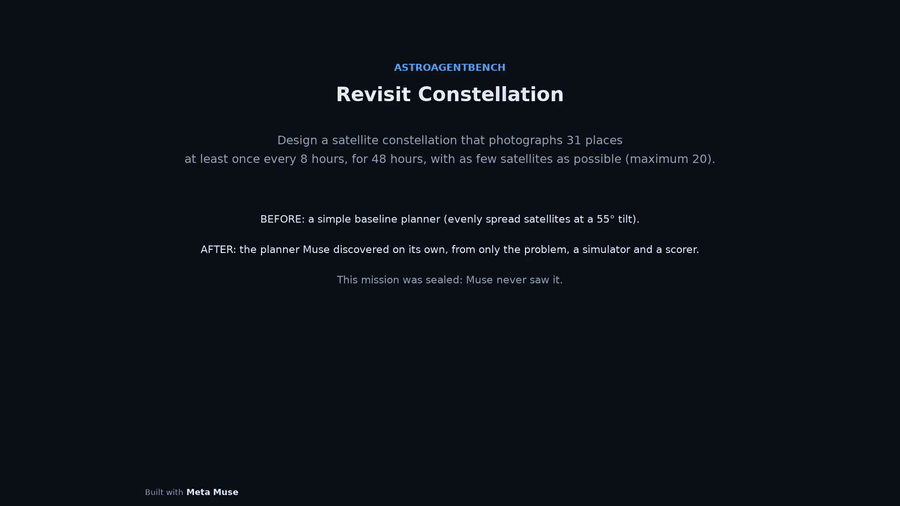

# Epoch Scientist

> Epoch Scientist tests whether Meta Muse Wonder can do science on its own. Muse works as an autonomous researcher in an autonomous discovery loop on AstroAgentBench satellite problems. It gets only the problem statement, a simulator, a locked scorer and a simple starting program: no internet, no research papers, no expert code. Muse proposes ideas, writes the code, scores it and keeps what works. Afterwards, we test its best program once on sealed missions and compare it with expert solvers that it never saw.

<p align="center"><a href="media/video/revisit_before_after.mp4"></a></p>

## What we claim

Every row uses one metric on one fixed set of missions Muse never saw during the search.

| Problem, missions, metric | Start program | **Meta Muse Wonder** | Expert solver |
|---|---|---|---|
| Satellite photo scheduling (AEOSSP): 5 test missions, mean score | 73.28 | **75.40** | MWIS 75.95, MILP 76.43 |
| Constellation design (Revisit): 5 sealed missions, mean score | 69.04 | **78.54** | j2 set cover 72.17 |
| Revisit: same 5 missions, mean satellites | 19.6 | **14.4** | j2 set cover 18.0 |

1. **Muse beat the expert constellation solver.** It scored higher on 4 of 5 sealed missions, with 20% fewer satellites.
2. **Muse closed 67% of the gap to the best-known schedule.** That is the gap from the start program to the MILP reference on
   the test missions. It also beat the start program on **23 of 23** sealed missions, and its plans stayed valid on all 6
   where the start plan was invalid.
3. **Muse debugged its own science.** On Revisit, it traced a score of 0 to a sign error in its own camera-angle check, fixed it,
   and went on to its best design. It named its best ideas itself: "Geometry-Diverse Constructive Growth" and
   "Contention-Priced Construction With Protected Iterated Ejection".

## What we do not claim

* **Not the best on every problem.** MWIS scores above Muse on all 8 AEOSSP missions where it ran.
* **Not the fewest satellites.** On the 5 Revisit test missions, the best published agent uses 11.4 satellites and Muse uses 16.0.
  This is not like-for-like: those agents planned each mission directly with hours of time, while Muse writes one general
  program that solves any mission in 200 s on one CPU thread.
* **Not every target on every mission.** All 11 sealed Revisit plans are valid; 9 meet every target, and 2 miss some.
* **Not an expert comparison on the hard missions.** No expert solver ran on the 6 AEOSSP missions where the start plan is
  invalid, so that gain is against our own start program.
* **Not one-of-a-kind discovery.** Each problem had one run and one seed. Blind means no look-ups, not an untrained model, and
  Muse mostly recombined known optimisation methods.

## How it works

<p align="center"></p>

**Meta Muse Wonder** (`meta/muse-wonder-1.0`) is the intelligence layer that drives all the reasoning: it proposes each idea,
writes and fixes the code, and learns from the scores. The locked scorer decides what is kept. Details:
[method](docs/method.md), [all 40 ideas](docs/ideas.md), [all results](docs/results.md).

Run logs (Weights & Biases):
[AEOSSP](https://wandb.ai/surya-ws2/aisci-aeossp/runs/bcw9vydb) and
[Revisit](https://wandb.ai/surya-ws2/aisci-revisit/runs/z3vvh4ce).

## The benchmark

[AstroAgentBench](https://github.com/Mtrya/AstroAgentBench) gives an agent the mission files and tools, then an independent
verifier scores its plan. We use two of its problems: [AEOSSP](docs/problem_aeossp.md) and
[Revisit](docs/problem_revisit.md). For more details, see the [paper](https://arxiv.org/abs/2601.11354) and
[our notes](docs/astroagentbench.md).

<p align="center"></p>

## Verify it

```bash
conda env create -f environment.yml && conda activate epoch-scientist
make fetch              # download AstroAgentBench (MIT) into external/
make check-verifiers    # frozen scorers are byte-identical to the official code
make smoke              # reproduces the Revisit start and best scores exactly
```

Full sealed evaluation and a new blind search: [docs/reproduce.md](docs/reproduce.md).

## Watch

* [Sealed Revisit mission](media/video/revisit_before_after.mp4): 20 → 10 satellites, every place on time.
* [Hard AEOSSP mission](media/video/aeossp_before_after.mp4): the start empties 3 batteries; Muse stays valid.
* [How Muse searches](media/video/search_revisit.mp4): a replay of the real run.

## Credits and licence

Our code: MIT ([LICENSE](LICENSE)). AstroAgentBench (MIT, OpenMOSS-Team) supplies the verifier code and mission files. The runner
uses OpenCode and AI-Scientist-v3 (Apache-2.0, Sakana AI), patched with `runner/patches/meta_provider.patch`. See [NOTICE.md](NOTICE.md).
