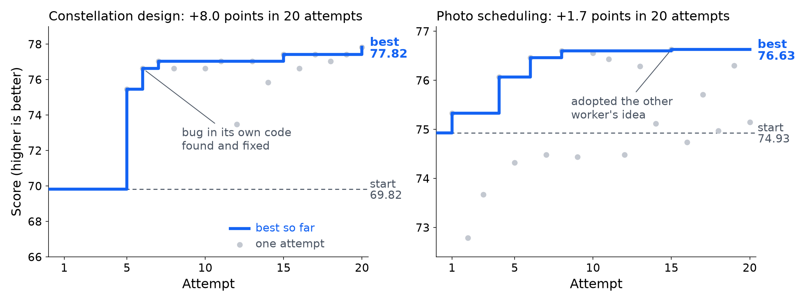

# Epoch Scientist

**Agentic research with Meta Muse Wonder.** Give it a problem as a prompt and a verifier. Meta Muse Wonder proposes ideas,
writes the code, tests it and keeps only what scores better.

<p align="center"><a href="https://youtu.be/866FbIutjNQ"></a><br>
<sub>▶ <a href="https://youtu.be/866FbIutjNQ">Watch the 2-minute explainer</a></sub></p>

## Results

Tested on two satellite problems from [AstroAgentBench](https://github.com/Mtrya/AstroAgentBench). Each program ran once on
missions Muse Wonder never saw.

| Constellation design, 20 new missions | Start | Muse Wonder | Expert solver |
|---|---|---|---|
| Score (higher is better) | 63.10 | **76.40** | 72.45 |
| Satellites (fewer is better) | 18.8 | **14.9** | 17.0 |

<p align="center"><br>
<sub>Best score so far during one 2-hour run per problem, on the practice missions. Failed attempts are not shown.</sub></p>

* Beat the expert solver on **18 of 20** new missions, with about 2 fewer satellites.
* Photo scheduling: better than its start program on **23 of 23** held-out missions; closed 67% of the gap to the best-known schedule.
* It found and fixed a bug in its own code (score 0 → 76.6).
* Open weights: Muse Spark on Baseten raised a practice score from 100 to 139.5 on a third problem ([record](results/wandb/trajectory_233j2q1l/)).

**Next:** repeat runs, and problems from other domains. Full results, comparisons and limits: [docs/results.md](docs/results.md).

## How it works

<p align="center"></p>

Two Meta Muse Wonder workers propose, code and test ideas for about 2 hours; the benchmark's own verifier decides what is
kept. Details: [method](docs/method.md), [all 40 ideas](docs/ideas.md), [run logs](results/wandb/).

## Quick start (no key, about 10 minutes)

```bash
conda env create -f environment.yml && conda activate epoch-scientist
make fetch check-verifiers smoke     # scores of the start and best programs reproduce exactly
bash demo/show_task.sh               # what Muse Wonder gets
python demo/replay_notebook.py results/revisit/notebook/aisci-revisit-blind-run.log --cost results/revisit/notebook/cost_summary.json
```

A full run takes about 2 hours, so the last command replays the real log of one run.

## Run it on your machine

```bash
cp .env.example .env                                      # add your Meta Model API key
python runner/local/run_local.py --task revisit --check   # free check: must print "HARNESS-PATH BASELINE 69.82... OK"
python runner/local/run_local.py --task revisit           # full run: about 2 h, about $30 (stops itself at $36)
```

Needs Linux (on macOS, use a Linux container), 4+ CPU cores, 16 GB RAM, 3 GB disk, no GPU.

## Bring your own problem

Anything a program can be scored on works. Make one folder, using `tasks/revisit/` as the example:

```
tasks/my_problem/
  task.md                    the problem in plain words, the program contract, the score
  evaluate.py                your verifier
  program_0/src/program.py   a simple start program (copy program_spec.toml from tasks/revisit/program_0/)
  idea_example.json          copy from tasks/revisit/ and edit
  rubrics_example.json       copy from tasks/revisit/ and edit
  requirements.txt
```

`python evaluate.py --program_path <program.py> --results_dir <dir>` must write `metrics.json` with `combined_score`
(higher is better). Keep all files at the top level, and keep your test data out of `--data-dir`.

```bash
python runner/local/run_local.py --task-dir tasks/my_problem --data-dir <dev data> --check
```

## Use it with your coding agent

Paste one prompt into Muse Code or the coding agent of your choice, in a clone of this repo.

**1. Run this project**

```text
Set up and verify this repo on my machine, following README.md "Quick start" and "Run it on your machine".
Run each command in order. Stop at the first failure and show me the last 30 lines.
Expected: `make smoke` reproduces the scores in README.md, and the check prints "HARNESS-PATH BASELINE 69.82... OK".
Do not start the full run (about 2 h, about $30) until I say so. Never print or commit MODEL_API_KEY.
Finish with a table: command, result, time.
```

**2. Try it on your own problem**

```text
Help me use this repo's agentic research on my own problem. Follow README.md "Bring your own problem",
with tasks/revisit/ as the example.

Problem: <the goal, in 2-3 sentences>
Data:    <path, and which part to keep for the final test>
Score:   <what makes one answer better than another>

1. Ask me if the goal, the data split or the score is unclear. Do not guess the score.
2. Build tasks/<name>/. Put only development data in the --data-dir folder.
3. Score program_0 by hand (one evaluation should take minutes), then run the free check until it prints "OK".
4. Ask me before the full run; it costs money.
5. After the run, score the best program once on the test data. Report start, best and test scores.
   Do not change evaluate.py after the run. Never commit .env, keys or the test data.
```

## Credits

MIT ([LICENSE](LICENSE)). Uses AstroAgentBench (MIT), AI-Scientist-v3 (Apache-2.0) and OpenCode (MIT); see [NOTICE.md](NOTICE.md).
