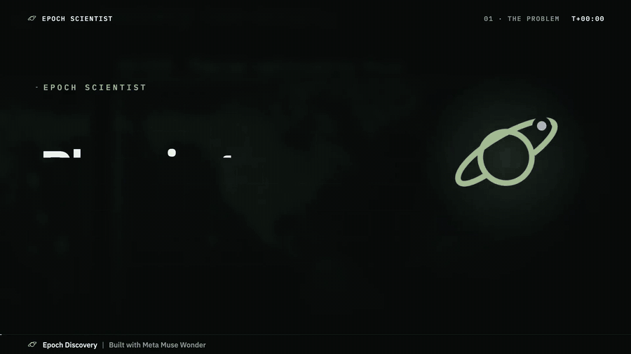
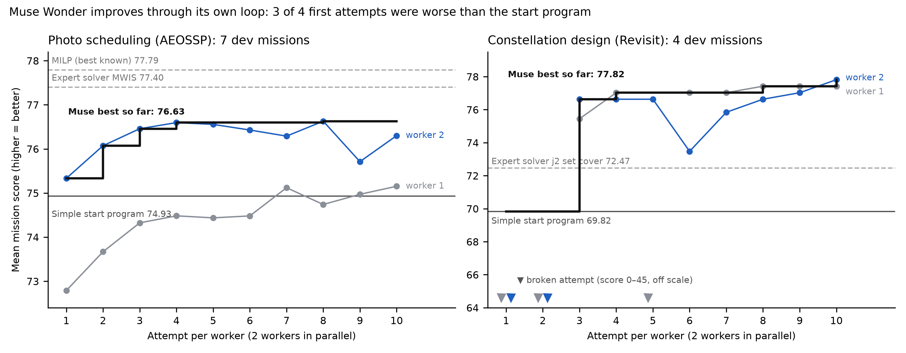
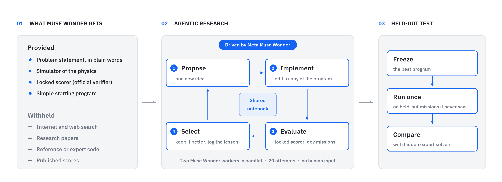
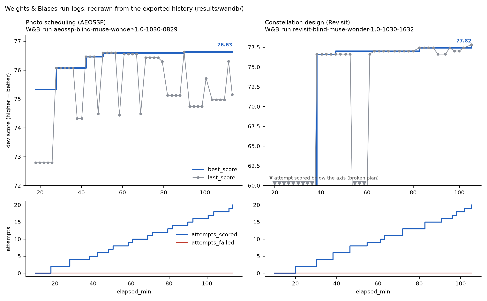
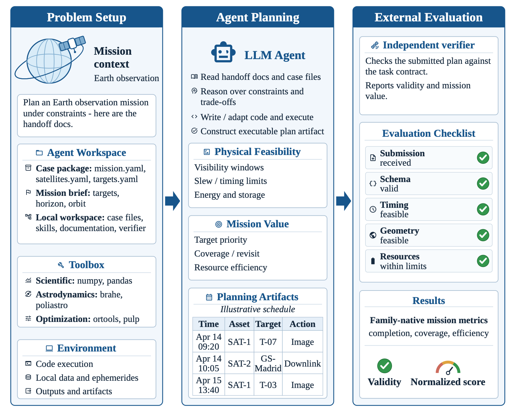

# Epoch Scientist

> Epoch Scientist tests whether Meta Muse Wonder can do science on its own. Muse works as an autonomous researcher in an autonomous discovery loop on AstroAgentBench satellite problems. It gets only the problem statement, a simulator, a locked scorer and a simple starting program: no internet, no research papers, no expert code. Muse proposes ideas, writes the code, scores it and keeps what works. Afterwards, we test its best program once on sealed missions and compare it with expert solvers that it never saw.

<p align="center"><a href="media/video/epoch_scientist_explainer.mp4"></a></p>

<p align="center"><sub>Sealed Revisit mission: start program 20 satellites · expert solver 15 · <b>Meta Muse Wonder 10</b>, every place on time.<br>
On 20 fresh missions made after the search, Muse's unchanged program beat the expert solver on <b>18 of 20</b>.<br>
▶ <a href="media/video/epoch_scientist_explainer.mp4">Watch the full 2-minute explainer</a>, narrated (click the preview).</sub></p>

## What we claim

Every row uses one metric on one fixed set of missions Muse never saw during the search.

| Problem, missions, metric | Start program | **Meta Muse Wonder** | Expert solver |
|---|---|---|---|
| Satellite photo scheduling (AEOSSP): 5 test missions, mean score | 73.28 | **75.40** | MWIS 75.95, MILP 76.43 |
| Constellation design (Revisit): 5 sealed missions with the expert run (train 5-9), mean score | 69.04 | **78.54** | j2 set cover 72.17 |
| Revisit: same 5 missions, mean satellites | 19.6 | **14.4** | j2 set cover 18.0 |
| Revisit: 20 fresh missions made after the search (new generator seed), mean score | 63.10 | **76.40** | j2 set cover 72.45 |
| Revisit: same 20 fresh missions, mean satellites | 18.8 | **14.9** | j2 set cover 17.0 |

1. **Muse beat the expert constellation solver, also on missions nobody had seen.** It scored higher on 4 of 5 sealed missions,
   with 20% fewer satellites. Then we made 20 fresh missions with the benchmark's own generator and a new seed, and wrote the
   rules down before running the expert. Muse's unchanged program beat the expert on **18 of 20** (sign test p = 0.0004), with
   12% fewer satellites; on 15 of 20 it used fewer satellites and met at least as many targets
   ([test and rules](results/revisit/fresh_missions/README.md)).
2. **Muse closed 67% of the gap to the best-known schedule.** That is the gap from the start program to the MILP reference on
   the test missions. It also beat the start program on **23 of 23** sealed missions, and its plans stayed valid on all 6
   where the start plan was invalid. On the 5 hard missions it lands between the two published solvers (MWIS 79.25,
   **Muse 78.54**, greedy_lns 75.15; [table](results/aeossp/hard_missions_yardsticks.csv)).
3. **Muse debugged its own science.** On Revisit, it traced a score of 0 to a sign error in its own camera-angle check, fixed it,
   and went on to its best design. It named its best ideas itself: "Geometry-Diverse Constructive Growth" and
   "Contention-Priced Construction With Protected Iterated Ejection". The loop mattered: 3 of its 4 first attempts scored
   below the start program, and the scores climbed from there.
4. **Muse wrote its own code.** Its best programs (800-1,300 lines) share 0.2-0.4% of their code sequences with the
   benchmark's reference solvers, close to the 0.0-0.1% they share with solvers for an unrelated problem; a renamed copy of a
   solver scores 99.4% ([check](analysis/code_originality.py), [results](results/code_originality.csv)).

<p align="center"></p>

## What we do not claim

* **Not the best scheduler.** MWIS scores above Muse on all 13 sealed AEOSSP missions where it ran, including the 5 hard missions
  (79.25 vs 78.54). On those 5 missions the start program is invalid (score 0), so the large gain there is over our own start
  program, not over the experts.
* **Not the fewest satellites.** On the 5 Revisit test missions, the best published agent uses 11.4 satellites, Muse 16.0 and the
  benchmark's reference solver 17.2; that solver meets every target, while Muse misses 5 targets on one mission.
  This is not like-for-like: those agents planned each mission directly with hours of time, while Muse writes one general
  program that solves any mission in 200 s on one CPU thread.
* **Not every target on every mission.** All 11 sealed Revisit plans are valid; 9 meet every target, and 2 miss some. On the
  20 fresh missions the expert meets every target on 17, Muse on 16. On a hand-made "cyclone watch" mission (30 cyclone-prone
  coastal cities, a photo every 6 h, 20 satellites) the expert meets every deadline and Muse misses 3 cities.
* **Not one-of-a-kind discovery.** Each problem had one run and one seed. Blind means no look-ups, not an untrained model, and
  Muse mostly recombined known optimisation methods.

## How it works

<p align="center"></p>

**Meta Muse Wonder** (`meta/muse-wonder-1.0`) is the intelligence layer that drives all the reasoning: it proposes each idea,
writes and fixes the code, and learns from the scores. The locked scorer decides what is kept. Details:
[method](docs/method.md), [all 40 ideas](docs/ideas.md), [all results](docs/results.md).

Run logs: both runs were logged live to Weights & Biases; the full records are exported in [results/wandb/](results/wandb/).

<p align="center"></p>

## The benchmark

[AstroAgentBench](https://github.com/Mtrya/AstroAgentBench) gives an agent the mission files and tools, then an independent
verifier scores its plan. We use two of its problems: [AEOSSP](docs/problem_aeossp.md) and
[Revisit](docs/problem_revisit.md). For more details, see the [paper](https://arxiv.org/abs/2601.11354) and
[our notes](docs/astroagentbench.md).

<p align="center"></p>

## Verify it

```bash
conda env create -f environment.yml && conda activate epoch-scientist
make fetch              # download AstroAgentBench (MIT) into external/
make check-verifiers    # frozen scorers are byte-identical to the official code
make smoke              # reproduces the Revisit start and best scores exactly
python analysis/code_originality.py   # Muse's code vs the benchmark's reference solvers
python analysis/score_fresh_missions.py   # fresh-mission test, from the stored plans (full rerun: bash analysis/fresh_missions.sh)
```

Full sealed evaluation and a new blind search: [docs/reproduce.md](docs/reproduce.md).

## Watch

* [2-minute explainer](media/video/epoch_scientist_explainer.mp4): the whole project in one narrated video ([captions](media/video/epoch_scientist_explainer.srt)).
* [Sealed Revisit mission](media/video/revisit_before_after.mp4): 20 → 10 satellites, every place on time.
* [Hard AEOSSP mission](media/video/aeossp_before_after.mp4): the start empties 3 batteries; Muse stays valid.
* [How Muse searches](media/video/search_revisit.mp4): a replay of the real run.

## Credits and licence

Our code: MIT ([LICENSE](LICENSE)). AstroAgentBench (MIT, OpenMOSS-Team) supplies the verifier code and mission files. The runner
uses OpenCode and AI-Scientist-v3 (Apache-2.0, Sakana AI), patched with `runner/patches/meta_provider.patch`. See [NOTICE.md](NOTICE.md).
