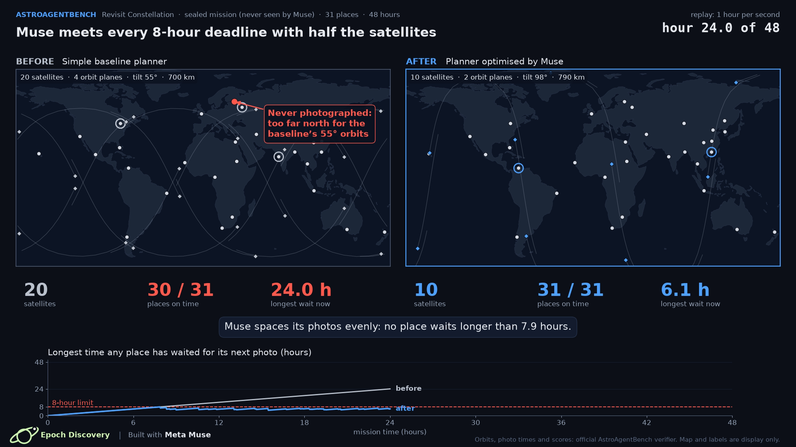
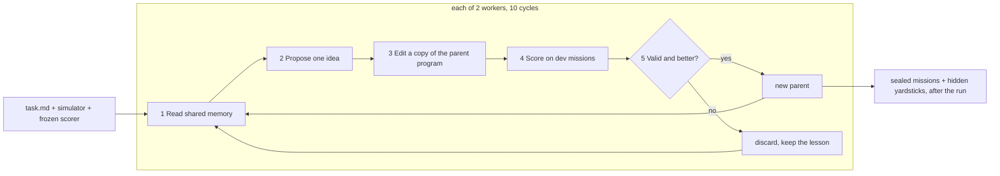

# Muse Scientist

> Muse gets only the problem, a simulator and a fixed score. With no internet, no papers and no reference code, it runs its own experiments from a simple baseline. Then we reveal the hidden expert solvers.

**Meta Muse Wonder as an AI scientist: it improves satellite mission planners on its own.**

Every idea, every line of code and every fix in this repository was written by **Meta Muse Wonder** (`meta/muse-wonder-1.0`).
Starting from a simple planner, it proposed, coded and tested one change at a time, and a frozen, official scorer decided what
was kept. It got only the problem statement, a simulator and the scorer: **no papers, no reference code, no web, no published
scores**. On both problems it beat its starting program, on sealed missions it never saw, for about $28 and under two hours
per run.

<sub>Around the model: OpenCode (coding-agent harness), Sakana AI-Scientist-v3 (search loop), AstroAgentBench (problems and official verifier).</sub>

We test this on two problems from [AstroAgentBench](https://github.com/Mtrya/AstroAgentBench)
([paper](https://arxiv.org/abs/2601.11354)), and judge every result on **sealed missions** that Muse never saw.

| | Earth-observation scheduling (AEOSSP) | Revisit constellation design |
|---|---|---|
| Task | 20-40 satellites choose which of ~1,700-4,000 photo requests to take in 12 h, without emptying any battery | design the smallest constellation that photographs every place at least every 6 or 8 h for 48 h |
| Start program | 73.28 (test score) | 67.35 (sealed mean score) |
| **Meta Muse Wonder (blind, 20 attempts)** | **75.40** | **77.07** |
| Benchmark solver | MWIS 75.95 (still higher) | j2 set cover: Muse wins on 4 of 5 sealed missions |
| Sealed missions | Muse beats the start on **23 / 23** | **11 / 11** valid (some targets missed on 2) |
| Other | hard mission: start invalid (3 empty batteries), Muse valid | satellites, 4 dev missions in total: 76 → 57 (solver 70) |
| Cost of the run | $27.66, 113 min | $29.10, 105 min |

<p align="center"></p>

## What Meta Muse Wonder found

* **Scheduling:** value-per-battery-cost construction, then "bump low-value photos to fit high-value ones", repeated with
  small random kicks; finally *prices on scarce resources during construction*, an idea worker 2 took from worker 1's
  shared lesson. Best: 76.63 on dev.
* **Revisit:** after 4 failed attempts it switched to "quick safe plan first, then improve", **found and fixed a sign error
  in its own camera-angle check**, then pruned satellites with full re-planning and finally grew the fleet from many orbit
  families (near-polar orbits). Best: 77.82 on dev with 57 satellites instead of 76.
* **Safety, not just score:** on the hard scheduling mission the start program drains 3 batteries and its plan is invalid;
  Muse Wonder's program stays valid.

## Watch

| Video | What it shows |
|---|---|
| [media/video/search_revisit.mp4](media/video/search_revisit.mp4) | how Muse searches: the 5-step evolutionary loop, then a replay of the real run (20 ideas, 2 workers) |
| [media/video/revisit_before_after.mp4](media/video/revisit_before_after.mp4) | sealed mission: 20 → 10 satellites, every place on time (score 67.7 → 85.8) |
| [media/video/aeossp_before_after.mp4](media/video/aeossp_before_after.mp4) | hard sealed mission: the start empties 3 batteries (plan invalid, score 0); Muse stays valid (77.9) |
| [media/video/search_aeossp.mp4](media/video/search_aeossp.mp4) | the search replay for the scheduling problem, including an idea passed from worker 1 to worker 2 |

## Run logs (Weights & Biases)

Both blind runs were tracked live in W&B (finished runs only):

| Problem | Run | Result |
|---|---|---|
| Satellite photo scheduling (AEOSSP) | [aeossp-blind-muse-wonder-1.0-1030-0829](https://wandb.ai/surya-ws2/aisci-aeossp/runs/bcw9vydb) | best dev 76.63, 20 programs scored |
| Constellation design (Revisit) | [revisit-blind-muse-wonder-1.0-1030-1632](https://wandb.ai/surya-ws2/aisci-revisit/runs/z3vvh4ce) | best dev 77.82, 20 programs scored |

## How it works



* **Blind task packs** (`tasks/`): a plain-language problem statement, a physics helper library (`sim.py`), the official
  AstroAgentBench verifier flattened into one frozen file, an evaluator with fixed time limits and SHA-256 integrity checks,
  and a deliberately simple starting program.
* **Search** (`runner/`): AI-Scientist-v3 drives the loop; each step is an OpenCode agent session running `meta/muse-wonder-1.0`
  through a Meta provider patch, on a Kaggle CPU notebook,
  web tools disabled, budget guard. Each worker keeps its own best valid program as the parent; all workers share lessons.
* **Judging** (`analysis/`, `yardsticks/`): the best program is re-scored on sealed missions and compared with the
  benchmark's reference solvers, an exact MILP (AEOSSP) and the published agent results.

Details: [docs/astroagentbench.md](docs/astroagentbench.md) (the benchmark and its simulation),
[docs/method.md](docs/method.md) (the search), [docs/problem_aeossp.md](docs/problem_aeossp.md),
[docs/problem_revisit.md](docs/problem_revisit.md), [docs/results.md](docs/results.md) (all numbers and limits),
[docs/ideas.md](docs/ideas.md) (all 40 ideas in plain words).

## Honest limits

* AEOSSP: Muse stays below the best published solver (MWIS) on every mission where MWIS exists; the gain on normal
  missions is modest (about +2 points). The large win is safety on hard missions.
* Revisit: the best paper agent (Claude Code + Opus 4.6) met every test target with 11.4 satellites on average; Muse needs
  15.4-16.0. The paper's agents planned each mission directly with hours of time; Muse writes one general program that
  must solve any mission in 200 s on one CPU thread.
* One run per problem, one seed. Muse mostly recombined known optimisation ideas; this is automatic engineering, not new science.

## Repository layout

```
tasks/        blind task packs given to Muse (aeossp/, revisit/): task.md, sim.py, evaluate.py, frozen verifier, program_0
runner/       Kaggle runner for AI-Scientist-v3 + OpenCode + Meta Muse; patches/meta_provider.patch (Apache-2.0)
data/         data operations: fetch AstroAgentBench, build world packs, re-flatten + identity-check verifiers, build Kaggle datasets
yardsticks/   hidden yardsticks: reference solvers, MILP bound, paper score, Walker sweep
analysis/     sealed evaluation, run-record extraction, paper-style metrics
results/      tables (summary.csv, per mission, ideas), best programs, run records (attempts, memory, shared lessons)
viz/          video renderers and replay exporters (all numbers from the verifier)
media/        videos and stills;  docs/  method, problems, results, ideas;  assets/  logos
```

## Quick start

```bash
conda env create -f environment.yml && conda activate muse-scientist
make fetch              # AstroAgentBench -> external/AstroAgentBench (MIT)
make check-verifiers    # frozen verifiers are byte-identical to the official code
make smoke              # starting programs reproduce their dev scores; best programs score one sealed mission
make sealed-revisit     # full sealed evaluation of the Revisit best program (~10 min)
make pack-aeossp        # build AEOSSP world packs (all splits), then: make sealed-aeossp
```

Running a new blind search with Muse on Kaggle: see [docs/reproduce.md](docs/reproduce.md).

## Credits and licence

Our code: MIT ([LICENSE](LICENSE)). AstroAgentBench (MIT, OpenMOSS-Team) verifier code and mission files; AI-Scientist-v3
(Apache-2.0, Sakana AI) is downloaded at run time and patched with `runner/patches/meta_provider.patch`. See [NOTICE.md](NOTICE.md).
