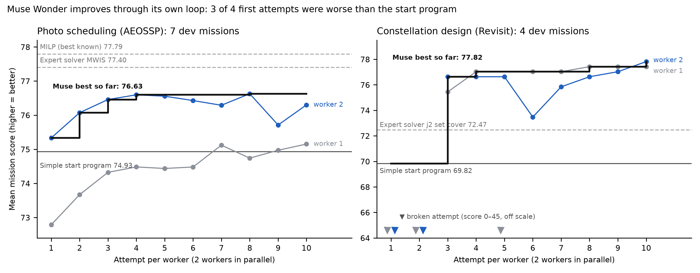

# Results and limits

All numbers come from the frozen official verifiers. Tables: `results/summary.csv`, `results/*/sealed_per_mission.csv`,
`results/*/ideas_table.csv`, yardsticks in `results/aeossp/yardsticks_train.csv`, `results/aeossp/hard_missions_yardsticks.csv` and
`results/revisit/yardstick_j2_solver.csv`; hard-mission solver plans in `results/aeossp/hard_yardsticks_raw/` (re-check with
`analysis/reverify_hard_yardsticks.py`); code originality in `results/code_originality.csv`; run logs in `results/wandb/`.

| | AEOSSP | Revisit |
|---|---|---|
| Model / attempts / workers | Muse Wonder 1.0 / 20 / 2 | Muse Wonder 1.0 / 20 / 2 |
| Cost, wall time | $27.66, 113 min | $29.10, 105 min |
| Failed attempts (crash or unscored) | 0 | 0 |
| Dev score: start -> Muse | 74.93 -> 76.63 | 69.82 -> 77.82 |
| Sealed | 23/23 missions better than start | 67.35 -> 77.07 mean (11 missions) |
| Versus the benchmark solver | below MWIS (75.40 vs 75.95 on test; 78.54 vs 79.25 on the 5 hard missions) | above j2 set cover on 4 of 5 sealed missions and on 18 of 20 fresh missions (76.40 vs 72.45; 14.9 vs 17.0 satellites) |
| Hard missions (5), start invalid | Muse valid on 5/5; MWIS 79.25 and greedy_lns 75.15 also valid on 5/5 | |
| Code shared with reference solvers | 0.35% (unrelated-problem floor 0.0%) | 0.33% (floor 0.05%) |
| Versus the paper's best agent | above Codex + GPT-5.4 (75.40 vs 72.91 on test)* | below Claude Code + Opus 4.6 (16.0 vs 11.4 satellites on test)* |

\* not like-for-like: the paper's agents worked per mission with hours of compute and (AEOSSP) computed geometry themselves;
Muse writes one general program under a fixed per-mission time limit.

## Limits
1. One run per problem, one seed.
2. Muse mostly recombined established optimisation methods (greedy construction, destroy-and-repair, ejection chains,
   Lagrangian prices, orbit-family search). This is automatic engineering, not new science.
3. Selection on development missions did not always pick the program that generalises best (Revisit runner-up).
4. The starting programs were written by us; the gains are measured from them, and the hidden yardsticks show where they sit.

## Fresh-mission test (Revisit, 2 Nov 2026)

20 new missions from the benchmark generator (seed 314159), rules fixed first ([PREREG.md](../results/revisit/fresh_missions/PREREG.md)). Muse beat j2 on 18 of 20; mean score start 63.10, Muse 76.40, j2 72.45; mean satellites 18.8 / 14.9 / 17.0; every target met 5 / 16 / 17; valid 20 / 20 / 20. Cyclone watch (30 cities, 6 h, 20 satellites): start 67.00 (3 missed), Muse 69.59 (3 missed), j2 70.00 (0 missed). Details: [results/revisit/fresh_missions/](../results/revisit/fresh_missions/README.md).

## Claims in detail

Every row uses one metric on one fixed set of missions Muse never saw during the search.

| Problem, missions, metric | Start program | **Meta Muse Wonder** | Expert solver |
|---|---|---|---|
| Satellite photo scheduling (AEOSSP): 5 test missions, mean score | 73.28 | **75.40** | MWIS 75.95, MILP 76.43 |
| Constellation design (Revisit): 5 held-out missions with the expert run (train 5-9), mean score | 69.04 | **78.54** | j2 set cover 72.17 |
| Revisit: same 5 missions, mean satellites | 19.6 | **14.4** | j2 set cover 18.0 |
| Revisit: 20 fresh missions made after the search (new generator seed), mean score | 63.10 | **76.40** | j2 set cover 72.45 |
| Revisit: same 20 fresh missions, mean satellites | 18.8 | **14.9** | j2 set cover 17.0 |

1. **Muse beat the expert constellation solver, also on missions nobody had seen.** It scored higher on 4 of 5 held-out missions,
   with 20% fewer satellites. Then we made 20 fresh missions with the benchmark's own generator and a new seed, and wrote the
   rules down before running the expert. Muse's unchanged program beat the expert on **18 of 20** (sign test p = 0.0004), with
   12% fewer satellites; on 15 of 20 it used fewer satellites and met at least as many targets
   ([test and rules](../results/revisit/fresh_missions/README.md)).
2. **Muse closed 67% of the gap to the best-known schedule.** That is the gap from the start program to the MILP reference on
   the test missions. It also beat the start program on **23 of 23** held-out missions, and its plans stayed valid on all 6
   where the start plan was invalid. On the 5 hard missions it lands between the two published solvers (MWIS 79.25,
   **Muse 78.54**, greedy_lns 75.15; [table](../results/aeossp/hard_missions_yardsticks.csv)).
3. **Muse debugged its own science.** On Revisit, it traced a score of 0 to a sign error in its own camera-angle check, fixed it,
   and went on to its best design. It named its best ideas itself: "Geometry-Diverse Constructive Growth" and
   "Contention-Priced Construction With Protected Iterated Ejection". The research process mattered: 3 of its 4 first attempts scored
   below the start program, and the scores climbed from there.
4. **Muse wrote its own code.** Its best programs (800-1,300 lines) share 0.2-0.4% of their code sequences with the
   benchmark's reference solvers, close to the 0.0-0.1% they share with solvers for an unrelated problem; a renamed copy of a
   solver scores 99.4% ([check](../analysis/code_originality.py), [results](../results/code_originality.csv)).

<p align="center"></p>

The same setup also runs with the open-weight **Muse Spark on Baseten**: on a third problem (space-probe routes) it raised the practice score from 100 to 139.5 in 164 min. The best program was not kept, so it has no held-out test (record and limits: [results/wandb/trajectory_233j2q1l/](../results/wandb/trajectory_233j2q1l/)).

## Limits in detail

* **Not the best scheduler.** MWIS scores above Muse on all 13 held-out AEOSSP missions where it ran, including the 5 hard missions
  (79.25 vs 78.54). On those 5 missions the start program is invalid (score 0), so the large gain there is over our own start
  program, not over the experts.
* **Not the fewest satellites.** On the 5 Revisit test missions, the best published agent uses 11.4 satellites, Muse 16.0 and the
  benchmark's reference solver 17.2; that solver meets every target, while Muse misses 5 targets on one mission.
  This is not like-for-like: those agents planned each mission directly with hours of time, while Muse writes one general
  program that solves any mission in 200 s on one CPU thread.
* **Not every target on every mission.** All 11 held-out Revisit plans are valid; 9 meet every target, and 2 miss some. On the
  20 fresh missions the expert meets every target on 17, Muse on 16. On a hand-made "cyclone watch" mission (30 cyclone-prone
  coastal cities, a photo every 6 h, 20 satellites) the expert meets every deadline and Muse misses 3 cities.
* **Not one-of-a-kind discovery.** Each problem had one run and one seed. Blind means no look-ups, not an untrained model, and
  Muse mostly recombined known optimisation methods.

## More checks

```bash
python analysis/code_originality.py       # Muse Wonder's code vs the benchmark's reference solvers
python analysis/score_fresh_missions.py   # fresh-mission test from the stored plans (full rerun: bash analysis/fresh_missions.sh)
```

Full held-out evaluation and a new blind search: [docs/reproduce.md](../docs/reproduce.md).

## Videos

* [2-minute explainer on YouTube](https://youtu.be/866FbIutjNQ): the whole project in one narrated video ([MP4 in the repo](../media/video/epoch_scientist_explainer.mp4), [captions](../media/video/epoch_scientist_explainer.srt)).
* [Held-out Revisit mission](../media/video/revisit_before_after.mp4): 20 → 10 satellites, every place on time.
* [Hard AEOSSP mission](../media/video/aeossp_before_after.mp4): the start empties 3 batteries; Muse stays valid.
* [How Muse searches](../media/video/search_revisit.mp4): a replay of the real run.
