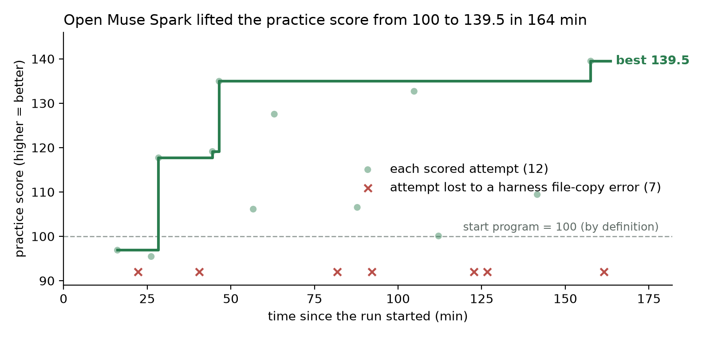

# Open-weight run: Muse Spark Open on interplanetary trajectory design (partial record)

This folder is the exported W&B record of one discovery run with the **open-weight model Muse Spark Open**
(`baseten/meta-models/muse-spark-open`, served by Baseten), in the same AI-Scientist-v3 + OpenCode loop that Muse Wonder uses.
W&B run `233j2q1l`, 31 Oct 2026, 12:30–15:07 UTC.

| | |
|---|---|
| Task | Design low-fuel routes for space probes (6 practice routes, ESA-style flyby problems, pykep physics) |
| Setup | 20 idea cycles × 2 workers, budget guard at about $85 |
| Run time | 163.6 min |
| Attempts | 19: 12 scored, 7 lost to a harness file-copy error (attempt folders missing `routes_dev.json`) |
| Start program | 100 by definition (route score = 100 × start-program delta-v / new delta-v) |
| Best practice score | **139.49** (12 of 12 runs valid, max solve time 18.6 s) |
| Best per route | EVVEJS 187.3 · EVEEJ 156.4 · EVEJ 145.8 · EVVMe 139.6 · EEM 107.7 · EMJ 100.2 |
| Estimated Baseten cost | $87.60 (token count × list price, cached tokens at full price, so an upper estimate) |

## What this shows, and what it does not

- It shows that the pipeline runs end to end with an open-weight Meta model as the scientist, and that Muse Spark Open
  improved the mean practice route score from 100 to 139.5 without help.
- It is **not** a sealed result. The run was started from the Kaggle editor, not as a saved version, so its output files,
  including the best program, were not kept. The program could therefore not be tested on the 8 sealed routes, and the
  prediction written before the run (sealed score ≥ 72.0 against expert optimisers) stays **not tested**.
- 139.5 is the best of 12 scored attempts on the same 6 practice routes, so it is selection-biased.

## Files

- `config.json`, `wandb-summary.json`, `run_info.json`: the run's configuration, final summary and timing.
- `history.jsonl`: every logged step (attempts scored and failed, best and last score, per-route scores, cost estimate).
- `plot_progress.py`: rebuilds `spark_trajectory_progress.png` from `history.jsonl`.
